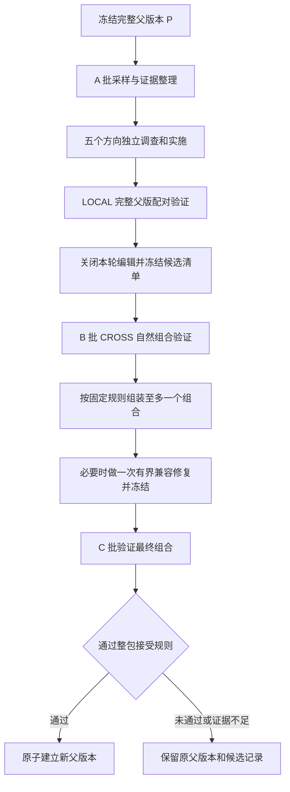

# ModularRSI 独立模块进化与跨批验证实施方案

状态：设计草案，待实现。日期：2026-10-08。

目标是恢复各模块独立研究和尝试的机会，同时保留优化版的并发执行、跨批验证和版本归档。第一版采用短周期：**同一个完整父版本 → 各模块独立提出和验证修改 → 验证组合 → 建立下一轮共同父版本。** 每轮允许没有修改通过。

这里的“进化”指修改 harness 代码和模块配置，不更新模型权重。周期化整合是拟增加的流程，效果需要实验验证。

## 1 为什么要这样改

已有调查发现三类需要分别处理的问题：

| 问题 | 对搜索过程的影响 | 对应改动 |
| --- | --- | --- |
| 所有模块共用少量提案和实施机会 | 一些方向尚未充分调查就退出队列 | 给每个模块独立的调查、实现和验证机会 |
| 摘要与提案接收丢内容，原任务和 harness 提示混在一起 | 有效提案丢失，也可能继续强化系统自己生成的错误要求 | 结构化接收，保留来源、修订和反证 |
| helper 可以执行，但强制部署和追踪不完整 | 候选实际没有被正确施加，或运行后被误判为没有运行 | 打通注册、组合、部署、执行和测量 |

独立进化只能直接处理第一类问题。另两类必须先修，否则新的调度仍会依据错误证据筛选候选。文字提示可以是有效修改；成功标准是发现可测量、可迁移的改进，不是减少某个目录中的代码或凑齐五种修改。

## 2 与公开版和实验版的关系

| 来源 | 继续采用的能力 | 本次需要补充的部分 |
| --- | --- | --- |
| 公开 ModularRSI | 模块独立探索、同题成败对照、跨任务证据、模块库和 niche archive、验证与回滚 | 将独立探索组织成可恢复的短周期，并主动比较当前父版与候选 |
| 优化版 crossbatch | 并发与 early-K、LOCAL/CROSS、执行预算、批次暴露记录、代级 archive 和快照检查 | 独立机会分配、完整父版对照、跨方向的 A/B/C/E 可见性账本、整合后的整包验证 |
| 新增周期控制器 | 每轮冻结父版，保留支线候选，有限整合 | 只有组合通过后才更新共同父版；失败时原父版继续有效 |

公开版已有[同题配对统计与回滚](../src/harbor/agents/terminus_2_modular/self_evo/confirm.py)，复用跨 epoch 的自然运行记录比较变体和 gen0；[双 lane 流程](../src/harbor/agents/terminus_2_modular/self_evo/two_lane.py)也已有独立 staging 与 rebase。新增的主动父版—候选执行不能描述为首次加入比较或回滚。

代码实施以保留 0914 优化的 archive 集成工作副本为开发基底。完成分阶段验证后，把审查过的功能补丁迁入公开 ModularRSI；保持现有[单模块入口](../scripts/evolve.sh)可用，新流程采用单独入口。

## 3 第一版的模块边界

第一版保留五个研究方向，每轮各自最多产生一个候选机制。以下映射以实验基底的现有模块 ABI 为准。

| 研究方向 | 可以修改的范围 | 重点调查的证据 |
| --- | --- | --- |
| 执行与规划 | `agent_loop`、`planner`，共用一份预算 | 决策、步骤推进、错误恢复和规划状态 |
| 工具 | `tools` 与其 `tool_helper` | 操作是否可执行、返回值是否可靠、能力入口是否缺失 |
| 观察 | `observation` | 有用信息是否被遗漏、截断或错误表达 |
| 上下文 | `context_mgmt` | 信息保留、检索、压缩和长期状态 |
| 完成判断 | `verification` | 完成信号与任务状态是否一致 |

`planner` 是实验实现里的额外槽位，归入执行与规划方向，不另加第六份预算，也不通过禁止修改 planner 人为降低其占比。该映射须同时用于对照组和新方案，并分别统计实际改动槽位。

公开版的 `ModuleBundle` 目前只有五个主槽位，没有 planner。迁移时先单独引入 planner 运行时接口及兼容适配，旧五槽配置保持原有行为；然后再接入新控制器。这是需要验证的接口增量，不能归为单纯调度改动。

helper 属于工具方向；新增或替换 helper 时保留父版其余 helper 及参数。执行与规划方向若同时修改两个槽位，必须在提案里声明，LOCAL 测量的是这一整项干预，不能拆称两个独立收益。

Kernel、Composer 的算法和 Protocol 在一轮实验内冻结。工程阶段可以修复接线及测量接口；修好后，两组实验使用相同版本。候选可以增加模块实现及其 archive 元数据，不能在演化中改评分器、验证规则或控制器。

确实需要跨研究方向协作的新能力，保留为 `requires_joint_change` 提案，记录依赖与证据。第一版不自动把它改写成提示补丁，也不因暂未支持而判定无效；通用多模块联合搜索留待后续。组合阶段只允许必要的兼容修复。

## 4 一轮进化怎样运行

### 4.1 冻结完整父版本

父版本 P 包含代码、模块目录、archive 状态、Composer 配置、运行参数和接口版本。生成内容哈希和 manifest，支线不能覆盖它。**本轮任何支线的结果都不直接更新共同父版本。**

每个任务的父版实际组合也要保存，包括模块名、参数和 helper 集合。模块目录相同不足以证明部署相同。

### 4.2 在 A 批上独立开发

共享父版在 A 批上的原始轨迹和带来源的证据。各方向独立调查；候选冻结前不互读其他方向的补丁、诊断或 LOCAL 反馈，防止先完成的方向影响其他方向。

每个方向最多选择一个机制，最多两次实现和 LOCAL 机会，即初次实现加一次修订。允许 `no_proposal`、证据不足或暂存提案。第一版不在周期中挪用其他方向的剩余预算。

周期开始前按候选上限预留 B、C 和一次兼容修复的预算，再分配调查与实现额度。预算预约按预声明的执行次数及单次资源上限计算，实际结算后释放余量。不能先耗尽预算，再以缺少 C 的结果宣称完成了一轮整合验证。

未选提案保留证据、适用范围和旧父版本指纹，不因 A 批离开就删除。跨周期继续研究时重新检查父版兼容性并登记预算；旧验证结果不能直接作为新父版的通过证明。

### 4.3 LOCAL 测量目标干预

对每个 A 任务先解析并冻结完整父版组合。对照臂执行该组合；候选臂保留未声明改动的槽位、参数和 helper，只施加声明的修改。不得把其余槽位退回 baseline。

默认重新运行与候选交错执行的父臂；最初供诊断的 A 轨迹保留为开发证据。不同候选可在预声明的同一测量窗口内共用完整父臂组，须同时满足部署和采样条件。复用较早诊断轨迹只能作为另行标记的节省方案，不能把时间差导致的运行条件变化当作已经控制。

目标没部署成功、指纹不一致或缺少执行记录时，结果标为测量无效。部署错误不算机制无效。目标已部署但触发条件未出现时，记录为缺少触发证据；目标执行过也不自动等于产生了预期行为。

A 参与了候选设计，LOCAL 用于开发筛选和检查副作用，不能作为泛化成绩。

### 4.4 全部冻结后开放 B

所有方向都必须处于“候选已冻结”或“本轮无候选”，才能开放 B。冻结清单包含候选哈希、支持证据、目标槽位、预期行为和测量指标。

B 上对 P 和各候选分别使用自然 Composer，测量真实部署效果。Composer 算法和参数固定，但候选库变化可能改变选择；所以 CROSS 是部署策略的整体比较，不是固定其他模块的纯机制消融。

先完成整轮 B 测量，再向组合阶段提供反馈。即使某方向较早结束，也不能据此修改尚未完成的候选。父版测量只有在代码、部署策略、任务版本、采样设置和比较窗口一致时才能复用；复用关系写入结果，不把共享对照当成多份独立样本。

### 4.5 整合与 C 验证

B 后按预先规定的规则收集通过且可测量的候选，合成至多一个组合。无合格候选直接结束本轮；只有一个候选时也进入整包 C 验证。

先做确定性兼容检查：文件与注册名冲突、模块参数、helper 依赖、archive 条目以及接口约定。最多允许一次兼容修复，范围限于解决这些交互问题，不能借整合新增另一项能力。修复后重跑静态与运行检查，并在已暴露的 A/B 上做必要回归。

仍有冲突则停止组合并保留父版；第一版不穷举候选子集。组合成员、修复内容和整包指标冻结后，才开放新的 C 批。

**C 每轮只验证一个冻结组合。** 通过则原子发布新的代码、archive 和 manifest；失败或证据不足则保留 P。C 反馈可供后续周期研究，但一旦用于改动，原 C 就不能再充当新候选的未见批次。

### 4.6 不同任务集的用途

| 任务集 | 允许的用途 | 何时成为已暴露证据 |
| --- | --- | --- |
| A | 诊断、实现、LOCAL、修订 | 开发开始时 |
| B | 冻结候选的 CROSS 筛选，随后指导组合 | 用于筛选或反馈后 |
| C | 冻结组合的接受或拒绝 | 参与本轮接受判断后 |
| E | 最终冻结版本的独立报告评测 | 不进入演化和版本选择；若据此继续改，后续正式评测须换新集合 |

A/B/C 都属于开发流程。B/C 只是在本轮对应版本冻结前不可见，不能对外称为最终独立测试集。所有集合记录任务 ID、内容哈希、数据版本和首次暴露阶段；跨集合重复任务或相同内容必须被检查出来。已经研究过的历史评测题可做回归，不能再次标成未见 E。

账本区分 `reserved → running → completed → feedback_exposed`。预约时就绑定任务和候选哈希；即使尚未产生最终判定，只要部分结果已被诊断、编辑或选择过程读取，就已构成反馈暴露。中断恢复只接续同一候选的同一操作，不能以“没有最终成绩”为由换候选后重用该批。

## 5 必须先完成的修复

### 5.1 证据和提案传递

逐条处理消息里的结构化报告，不再用拼接全部会话后的标签正则寻找“最后一份报告”。报告、完成声明和工具输出分开存储；只有显式声明的有效修订才能替换上一版本。旧标签格式可保留逐消息兼容读取，但错误必须显式报告。

每份提案保存 `proposal_id`、`revision`、父版指纹、所属研究方向、实际改动槽位、`causal_hypothesis`、`expected_change`、支持与反证引用、依赖、主指标和成本预算。重复输出不得改变候选顺序；缺字段或失效引用不能静默通过。

证据分别标注原始任务、harness 注入、solver 自测、环境返回和开发阶段允许访问的 verifier 事实。引用要包含任务与 trial 身份、文件位置和内容摘要哈希；检查文件确实存在且在当前可访问范围内。候选调查必须允许提出“现有 harness 的要求错了”。

超出摘要预算时保存完整报告，提供结构化索引与进一步读取入口；不能截断后把缺失内容当作完整调查。每个方向可在自己的预算内读取相关模块源码和上游轨迹，不统一限制为最后几个步骤。

### 5.2 部署和行为测量

统一模块与 helper 的注册、组合、pin、加载、执行和追踪路径。实验模式遇到未知槽位或 helper pin 不合法时直接报部署失败，不能静默退回 baseline。

至少记录三层事实：实际安装了哪个版本、是否调用了它、是否发生提案预期的行为。例如工具执行事件应关联 invocation ID、执行状态和真实返回结果；一次方法调用不能代替“命令执行成功”，一次提示注入不能代替“策略被遵循”。

`expected_change` 保存触发条件、预期事件及反证条件。第一版只自动检查框架已有可靠事件和明确的观测字段；超出能力的语义主张保留为待分析，不用另一段未经验证的模型判断伪装成机械合同。

### 5.3 验证有效性与效果分开

健康检查判断加载、执行、异常和超时；效果检查判断正确率与成本。只有具有版本化校准依据的任务才可作为 must-pass sanity；新换的开发题不能直接继承旧集合“父版总能通过”的假设。

第一阶段修复解析和部署时不顺手调效果阈值。新周期流程采用单独版本化的接受策略，所有比较组共同使用：

| 层次 | 第一版规则 |
| --- | --- |
| LOCAL | 复用现有准确率/效率筛选规则，增加完整部署与预期行为记录 |
| B 准确率候选 | LOCAL 通过、有效配对数足够、无超出既定噪声带的正确率或超时退化，且有自然选择证据；这是组合资格，不是已证实提升 |
| B 效率候选 | 除上述条件，还需预声明的成本指标在双方所有重复执行均成功的任务上下降并越过既定噪声带 |
| C 组合 | 部署有效且存在新改动的实际生效证据；正确率与超时均无超出噪声带的退化，并且冻结时声明的一个主指标改善超过该指标的噪声带；证据不足保留父版 |

工程 pilot 初值沿用现有统计参数：至少 6 个有效任务配对、噪声带为任务级配对差的 `1.25 × SE`，效率统计至少 3 个双方所有 K 次执行均成功的任务配对。它们是开发筛选参数，**不是 95% 置信保证**。整合只有准确率候选时主指标为准确率；全部为效率候选且声明同一指标时使用该指标；其余情况在运行前固定为准确率，不能看 C 后换指标。

新策略中的有效任务配对要求两臂各有完整 K 次有效观测。基础设施缺测可在预声明的重试预算内补齐，否则该任务整对排除并报告原因；agent 自身错误、失败和真实超时保留为观测，不能作为缺测剔除。旧 `TaskPair.valid()` 和 `solved_pairs()` 接受部分有效 rollout 的行为不足以满足这一定义，须随新策略单独升级，避免出现三次对一次的比较。

C 中没有触发的组合成员单独标记为未验证，不能把整包通过解释为每个成员都有效。效率指标在双方均成功的子集上统计，同时报告全体任务的正确率和成本，避免把子集节省说成整体节省。

新周期中，B 证据不足的候选只留档，不进入本轮组合；这区别于旧流程允许部分准确率候选带 `unvalidated` 状态晋升的规则。C 接受规则也是新增规则，应单独实现和测试，不能藏在接线修复里。

状态需区分 `invalid_measurement`、`not_triggered`、`insufficient_evidence`、`measured_no_gain`、`regressed`、`budget_exhausted` 和通过。父版全失败但候选没有改善属于结果信号不足的筛选情形，不能与“模块没有正确部署”混为一谈。未显著退化也不等于统计证明不劣。

## 6 状态预算和归档

拟新增 `cycle_state.py` 保存周期状态，控制器负责状态转换，测量器负责执行。记录最小集合如下：

| 记录 | 内容 |
| --- | --- |
| 周期 manifest | 周期 ID、父版哈希、代码/archive/配置哈希、门禁策略版本 |
| 各方向状态 | 调查结果、提案与修订、候选哈希、剩余机会、退出原因 |
| 预算账本 | 调查、editor、solver、重试、组合修复的已预约与已发生消耗 |
| 暴露账本 | A/B/C/E 归属、内容哈希、允许读取的角色、首次暴露与后续用途 |
| 测量记录 | operation ID、trial ID、完整实际组合、重复次数、事件、结果和无效原因 |
| 组合记录 | 成员候选、依赖、冲突、修复补丁、接受结果和发布事务 |

启动模型或任务前先持久化操作身份和预算预约；恢复时核对已有 trial 与结果，再接续同一操作。状态不明的执行不得直接启动副本。失败重试也计入真实成本；模型输出、代码版本和任务暴露都不能随重启重置。

保留优化版的全局 solver/editor 并发配额、early-K、Docker 启动控制、取消和恢复机制。五条支线共享这些配额，不各自再开一套满并发。early-K 发布可用结果前仍须校验代码、组合和 archive 指纹一致。

完整快照准备好后，原子切换当前父版指针；崩溃只能留下旧完整版本或新完整版本。archive 更新不能放在代码晋升后的“尽力同步”步骤。组合失败的候选保存在研究记录里，不标成当前有效模块；成功版本保留可兼容的既有 niche 变体，不强制每题启用全部新模块。

## 7 文件改动与提交顺序

下面是拟定边界。文件名基于实验版布局；新增项尚不存在，迁移公开版时按其依赖拆分。避免把新状态机继续堆入现有单窗口函数。

| 阶段 | 主要文件或新增组件 | 完成标准 |
| --- | --- | --- |
| P0 固定开发基底 | 基底 manifest、已有补丁清单、运行依赖清单 | 0914 优化和 archive 改动可追溯；现有未提交改动单独保存 |
| P1 修复证据 | `digest.py`、`crossbatch_audit.py`、`proposal_pool.py`、`run_editor.py`；结构化证据类型 | 历史会话回放不丢合法报告/提案、不改变顺序；来源和 `expected_change` 完整到达 editor |
| P2 修复测量 | `paired_runner.py`、Composer/pin 读取、`kernel/orchestration.py`、helper 执行事件、sanity 校准 | 完整父版仅目标发生变化；helper 可强制部署并被真实追踪；健康与效果门禁各有依据 |
| P3 独立周期 | 新增 `module_cycle.py`、`cycle_state.py`；复用池、调度器和 `k_roll.py` | 五方向机会独立、允许无提案、冻结屏障与暴露账本生效、恢复不重复执行 |
| P4 有界整合 | 新增 `cycle_integration.py`；适配 `conflict_scan.py`、`paired_eval.py`、`crossbatch_archive.py`、promotion 事务 | 最多一个组合、一次兼容修复、新 C 验证、代码与 archive 一致发布或回退 |
| P5 入口与实验 | 新增 `scripts/evolve_cycle.sh`、配置样例、回放与结果汇总脚本 | dry-run 可看预算和数据用途；小规模流程验证后才能做效果 pilot |

旧 `run_in.py` 的冲突检查和审查逻辑可以复用，但不能直接充当整合控制器：新流程需要完整父版配对、代级 archive 事务和暴露管理。公开版缺失的 crossbatch 基础文件属于新增依赖，不能假设复制启动脚本就能运行。

每个阶段独立审查和提交。先把公共依赖与接线修复整理清楚，再引入新调度，最后加入组合接受策略，方便定位效果来自哪里。本文不改变 README 的两项发布计划；实现、验证与对外发布分别推进。

## 8 怎样验证第一版

### 8.1 先做不调用模型的回归

1. 用脱敏后的历史消息构造回放：完成声明不得覆盖报告；提及标签不得吞掉后续 JSON；重复提案不得改变选择顺序。
2. 原任务、注入要求和 verifier 事实分别保留；失效引用和越阶段读取应明确失败。
3. 父版使用非 baseline 模块、非默认参数和多个 helper，验证候选只改声明目标；未知 pin 不得降级。
4. 使用可控执行环境验证 helper 的成功、非零返回、异常和未触发，核对部署、调用与行为事件分别正确。
5. 用确定性假 runner 覆盖无提案、预算不足、候选冻结前请求 B、B 后修改候选、组合冲突、C 失败和零晋升。
6. 在预算预约、trial 启动、结果落盘和发布切换处模拟中断，验证恢复不重复提交运行，且 code/archive 一致。

### 8.2 再验证真实执行链

用已有开发题做小型 canary，至少覆盖自然组合与强制部署、一个普通模块与一个 helper、early-K 和中断恢复。这一步验证能正确执行和记录，不据此评价新演化方法更好。

### 8.3 最后做有预算的小规模对照

先跑一轮完整流程，再考虑两轮效果 pilot。示例规模为每轮 A/B/C 各 10 题、每题 K=3；预算必须在启动前按实际候选数核算，不能只说“30 题所以很便宜”。

若五个候选都进入测量，且每阶段父版对照都满足复用条件，一轮首次执行的参考预算为 A 诊断采样 30 次、LOCAL 的 `(1+5)×10×3=180` 次、B 的 180 次、C 的 60 次，共 **450 次 solver trial**。修订、sanity、回归、重试、editor 调用和最终 E 另计；不满足共用父臂条件时还需增加执行预算。若另行允许把早期 A 诊断父臂用于 LOCAL，可减到 420 次，但须明确时间偏差和完整实际组合一致条件，不作为默认预算。

效果比较采用同一修复后基础设施、父版、模型、任务序列、可编辑边界和总预算：

| 对照组 | 新方案组 |
| --- | --- |
| 共享诊断和候选队列，不保证每个方向分到机会 | 五方向独立诊断与候选机会 |
| 同样最多五个候选，同样的总调查/实现/验证预算 | 每方向最多一个候选，合计同样上限 |
| 使用同样的父版冻结、LOCAL/B/C、整合和接受策略 | 使用同样的父版冻结、LOCAL/B/C、整合和接受策略 |

这个对照隔离的是机会分配方式，不是对历史单窗口实现的逐字复刻。历史成绩可作背景，不能当等预算随机对照。整合、失败尝试和无提案调查都计入总成本；预算不足就停止，不临时扩容某一组。

这里的预算一致首先指相同资源上限和停止规则；无提案等情况会导致实际消耗不同，结果必须分别报告。若比较同成本收益，使用预声明的共同预算刻度记录检查点，不把未用额度计成已经花费。

每组最终版本冻结后在新 E 上评测初始父版和最终版本，输出任务级配对差及不确定性。统计模块位置、实际行为方式和功能意图三个维度，同时报告有效部署率、预期行为发生率、候选效果、组合退化和总成本。机制更丰富或晋升更多都不能单独证明性能更好。

## 9 当前下一步

先完成 P0–P2：固定优化版基底，修复证据传递和完整父版/helper 测量，并交付离线回放结果。随后实现 P3–P4 的最小周期，用假 runner 验证整个状态机，再做真实 canary 和预算明确的效果 pilot。

这是一次集中在演化控制、证据和验证链路的中等偏大改造。已有模块接口、任务执行和并发优化可以复用；新周期状态机与整合事务需要单独实现。先获得可信的提案与测量，再扩大题量，才能判断方案是否改善了我们真正关心的搜索问题。
